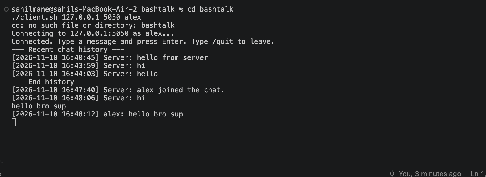

# BashTalk

BashTalk is a small terminal chat application written in Bash. It uses TCP and
IP addresses so two laptops on the same network can have a plain, real-time
conversation. There is no GUI and no special terminal interface: type a line,
press Enter, and see messages as they arrive.

This first version is deliberately small. One server operator can chat with one
remote client at a time. Clients can disconnect and reconnect, and the server
saves chat history and sends it to each client when it connects. Multi-user
rooms, encryption, and file sharing are the next milestones rather than
features this version only claims to have.

## Files

- `server.sh` starts the TCP server, displays the conversation, and saves it to
  `data/chat-history.log`.
- `client.sh` connects a laptop to a server using an IP address, port, and
  username.
- `lib/common.sh` contains the small shared checks and netcat compatibility
  helper used by both scripts.

## Requirements

- Bash 3.2 or newer (works with the Bash that ships on macOS).
- Netcat, available as the `nc` command. It is normally already installed on
  macOS and many Linux distributions. On Debian or Ubuntu, install it with
  `sudo apt install netcat-openbsd` if needed.

Make the scripts executable once:

```sh
chmod +x server.sh client.sh
```

## Run locally

Open two terminal windows in this project directory.

In the first terminal, start the server on a port such as `5050`:

```sh
./server.sh 5050
```

In the second terminal, connect a client:

```sh
./client.sh 127.0.0.1 5050 alex
```

Type in either terminal and press Enter. Type `/quit` in the client to leave,
or in the server terminal to end the server. The complete history is retained
at `data/chat-history.log` until you choose to remove that file.

## Example session

The client receives recent history when it connects, then prints new messages
as they arrive.



## Chat between two laptops

1. Put the laptops on the same trusted network.
2. On the server laptop, find its local network address. On macOS, try
   `ipconfig getifaddr en0`; on Linux, use `hostname -I` or `ip addr`.
3. Start the server, for example `./server.sh 5050`.
4. If the operating system firewall asks, allow incoming connections for this
   terminal or port. Do not expose this basic version directly to the internet.
5. On the other laptop, copy the project (or at least `client.sh` and
   `lib/common.sh`) and run:

   ```sh
   ./client.sh SERVER_IP 5050 your-name
   ```

   Replace `SERVER_IP` with the address from step 2.

If it cannot connect, first confirm both devices can reach each other on the
network and that the selected port is allowed by the server laptop's firewall.

## Test checklist

1. Start the server and client locally using the commands above.
2. Send a message from the client and confirm it appears in both terminals
   with a timestamp and username.
3. Send a message in the server terminal and confirm it appears in the client.
4. Disconnect the client with `/quit`, reconnect, and confirm the prior chat
   appears between the history markers.
5. Repeat using two laptops on the same network.

## Next milestones

- Multiple concurrent clients and broadcast messages.
- Encrypted connections with a reviewed TLS-based approach.
- File transfer with size limits, validation, and explicit consent.

Until encryption is added, treat messages as private only to the extent that
your local network is private.
